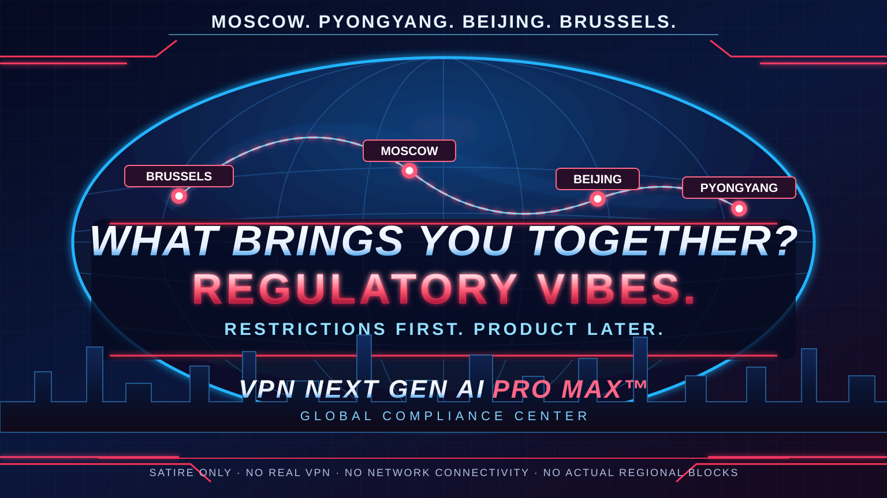

# VPN Next Gen AI Pro Max™ 🚀🦀

<p align="center"><strong>The world's most next-generation AI-powered quantum-adjacent VPN.</strong><br/><em>Now with Pro. And Max. Tunnel coming soon.</em></p>

<p align="center">


</p>



*Satirical promotional artwork. The product has no VPN connectivity, and the regional restrictions are fictional.*

> [!CAUTION]
> **THIS IS A PARODY. NOT A REAL VPN.** It does not create tunnels, encrypt traffic, provide privacy, sell subscriptions, or offer investments. Do not use it for network security.

## 🚀 Interplanetary Connectivity™ — Starman Edition

**Our signal to Elon Musk's Tesla Roadster in space travels at nearly the speed of light!***

**299,792,458 m/s** theoretical signal propagation speed in vacuum. **0 packets sent. 0 tunnels established.**

*The laws of physics describe the theoretical speed, not our actual VPN. No signal is being sent; throughput and RTT are undefined. Our space division is entirely fictional.*

**[→ Interplanetary Connectivity: Read the Whitepaper](docs/INTERPLANETARY_CONNECTIVITY.md)**

## 🏆 Why Choose Us?

**Because other VPNs are distracted by things like *working*.**

- **Zero-copy architecture:** zero packets transmitted, zero packets copied.
- **Interplanetary speed:** the speed of light is remarkably fast when you don't actually transmit anything.
- **AI-native:** it says AI in the product name. Due diligence complete.
- **Global compliance:** we have fictional UK and Australia restrictions *before* launching a network service.
- **Precision benchmarking:** no false 0 ms p99 — we report **undefined**, as mathematics intended.
- **No vendor lock-in:** there's no vendor service to lock you into.
- **Rust-powered:** the compiler is our most senior engineer.
- **Interplanetary speed:** our marketing reaches Elon Musk's Tesla Roadster at almost light speed. The actual VPN still sends zero packets. [Starman Edition →](docs/INTERPLANETARY_CONNECTIVITY.md)

> "I've never experienced a VPN provider with this much documentation and this little VPN." — **Independent Analyst (fictional)**

**[→ See all the reasons to choose us (and why you shouldn't use it as a VPN)](docs/WHY_CHOOSE_US.md)**

## 📰 Press & Media

**"If the press won't cover us, we'll cover ourselves."** — Department of Corporate Narratives

**Independent coverage:** 0 articles. **Self-produced coverage:** 4 major exclusives. **Editorial control:** 100%.

> "Startup disrupts cybersecurity by not launching a VPN." — **Our own Press Office (fictional)**

From the world's first **undefined-p99 performance breakthrough** to an **interplanetary Tesla Roadster rollout with zero packets**, our communications team has been exceptionally busy.

**[→ Read the Press & Media Center — every headline written by us](docs/PRESS.md)**

## 📚 Documentation — Enterprise Knowledge Center

Our documentation is production-grade. Unlike the product.

| Start here | Engineering | Governance |
| --- | --- | --- |
| [Getting started](docs/GETTING_STARTED.md) | [System architecture](docs/ARCHITECTURE.md) | [Security model](docs/SECURITY.md) |
| [CLI reference](docs/CLI_REFERENCE.md) | [NGT/0 protocol spec](docs/PROTOCOL.md) | [Regional compliance](docs/COMPLIANCE.md) |
| [Operations runbook](docs/OPERATIONS.md) | [Benchmark methodology](docs/BENCHMARKS.md) | [Architecture decisions](docs/adr/README.md) |
| [FAQ](docs/FAQ.md) | [Product status](docs/STATUS.md) | [Investor relations](docs/INVESTOR_RELATIONS.md) |
| [Why choose us?](docs/WHY_CHOOSE_US.md) | [Interplanetary Connectivity™](docs/INTERPLANETARY_CONNECTIVITY.md) | [Press & Media](docs/PRESS.md) |

**[→ Browse the entire documentation portal](docs/README.md)**

### 🌐 Regional availability: UK & Australia

Our compliance division has deployed a **fictional** regional restriction simulator. It performs no IP lookup, location detection, or network blocking — the region is **only the text you type**.

~~~sh
cargo run -- geo-check uk     # BLOCKED: awaiting tea-based identity verification
cargo run -- geo-check au     # BLOCKED: kangaroo-grade compliance review
cargo run -- geo-check other  # APPROVED: still no VPN
~~~

No real jurisdiction or law is being described here. Read the full [Global Compliance Dossier](docs/COMPLIANCE.md).

## The disruptive vision

Other VPNs sell speed, privacy, and reliability. We sell **more adjectives**.

- **Zero-copy:** We copy zero packets because we transmit zero packets.
- **Zero trust:** We don't even trust our own benchmarks.
- **AI-native:** The AI is right there in the name.
- **Memory-safe:** Rust protects the zero bytes we process.
- **Post-quantum readiness:** Quantum computing is on the roadmap, probably.
- **Unlimited scalability:** From zero users to zero users, horizontally.
- **Latency optimization:** We have eliminated all network round trips by omitting the network.

## 🎁 Activate your FREE VPN

No credit card, no registration, no sudo, no mysterious remote installer.

With Rust installed:

```sh
git clone https://github.com/tavvet/vpn-next-gen-ai-pro-max.git
cd vpn-next-gen-ai-pro-max
cargo run -- free
```

Or with only Bash:

```sh
bash scripts/free-vpn.sh
```

**What happens:** the local program prints jokes. It does not open network sockets, read secrets, change DNS, touch firewalls, or install anything. (Of course, `git clone` downloads the repo and Cargo creates local build artifacts.) Inspect the source before running it.

**What does not happen:** a VPN connection. We feel very strongly about transparency.

## Enterprise-grade commands

```sh
cargo run -- --help
cargo run -- connect
cargo run -- benchmark
cargo run -- audit
cargo run -- geo-check uk
cargo run -- geo-check au
cargo run -- ipo
cargo test
```

## The most honest benchmark in the VPN industry

| KPI | Result | Methodology |
| --- | --- | --- |
| Throughput | N/A | No data transmitted |
| RTT overhead | N/A | No connection established |
| p99 latency | N/A | Zero samples |
| Packet loss | N/A | Undefined when no packets are sent |
| Copies of transmitted packets | **0** | Zero-copy, zero-packet architecture |
| Company valuation | **$25B** | Unverified founder confidence |

> Only amateurs report 0% packet loss with zero sent packets. Professionals report **undefined** and immediately prepare their pitch deck.

## Pricing

| Plan | Monthly price* | What you receive |
| --- | ---: | --- |
| Free | $0 | No VPN |
| Pro | $19.99 | No VPN, priority optimism |
| Pro Max | $49.99 | No VPN, roadmap in 4K |
| AI Pro Max Ultra | $199.99 | AI investigates why your p99 is undefined |
| Enterprise Quantum Founder | Contact Sales | We will invent the Sales department |

*All prices are fictional. No money is collected. No subscriptions exist.*

## Architecture

See the [architecture reference](docs/ARCHITECTURE.md), [formal NGT/0 protocol](docs/PROTOCOL.md), [security whitepaper](docs/SECURITY.md), and [benchmark methodology](docs/BENCHMARKS.md).

```text
[User Expectations] --> [Rust CLI] --> [stdout: "COMING SOON"]
                                X
                            [Internet]
                      (not connected)
```

## Roadmap

- [x] Name the product.
- [x] Add Next Gen, AI, Pro, and Max.
- [x] Write it in Rust.
- [x] Create the GitHub repo.
- [x] Ship a harmless CLI.
- [ ] Decide whether networking is within the scope of a VPN.
- [ ] Publish the benchmark that measures no traffic.
- [ ] Add Ultra.
- [ ] IPO.
- [ ] Consider implementing a VPN as a post-IPO stretch goal.

See [ROADMAP.md](ROADMAP.md), [Product Status](docs/STATUS.md) and [Investor Relations](docs/INVESTOR_RELATIONS.md).

## FAQ

**Does it work?** Yes, the CLI starts.

**Is it a VPN?** No.

**Is there a kill switch?** The entire product starts switched off.

**How does AI lower latency?** The AI thinks about latency.

**Why Rust?** The compiler is our most experienced employee.

**What's the difference between Pro and Pro Max?** Max.

**Does it collect telemetry?** The executable doesn't collect anything.

**Can I get a refund?** We will return the full $0 you paid.

**Can I contribute?** Yes. See [CONTRIBUTING.md](CONTRIBUTING.md).

**Is it available in the UK or Australia?** In reality, the CLI runs everywhere. In our imaginary compliance universe, the paperwork has concerns. [Details](docs/COMPLIANCE.md).

**Where are the docs?** [All 13 departments have filed their reports.](docs/README.md)

---

*Satire. Not affiliated with any actual VPN vendor or AI company. No networking features provided.*
