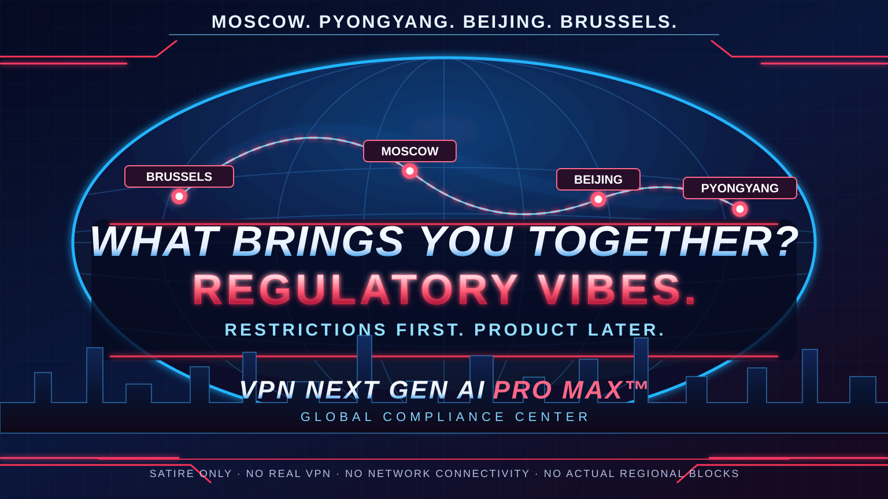

# Global Compliance & Regional Availability

**Policy ID:** GLOBAL-REGULATORY-VIBES-001  
**Last review:** Pending · **Legal standing:** None (parody) · **Customer impact:** Zero

> [!IMPORTANT]
> This is a **fictional joke about corporate geoblocking**, not a statement of actual UK or Australian law, government policy, or third-party provider restrictions. VPN Next Gen AI Pro Max™ is **not a real VPN**.

## Executive statement

Our compliance organization is committed to meeting all hypothetical legal obligations while avoiding the inconvenience of implementing a product.

To demonstrate readiness, we have launched **Regulatory Vibes-as-a-Service (RVaaS)**.

### Regional policy matrix

| Jurisdiction selected by user | Simulated disposition | Reason in the fictional universe |
| --- | --- | --- |
| 🇬🇧 United Kingdom (\`uk\`) | **BLOCKED — PENDING TEA-BASED VERIFICATION** | The Department of Extremely Serious Tunnels requires a properly steeped risk assessment |
| 🇦🇺 Australia (\`au\`) | **BLOCKED — KANGAROO REVIEW** | Zero packets have not yet passed the mandatory upside-down compatibility test |
| 🌍 Other (\`other\`) | **APPROVED — PRE-PRODUCT ACCESS** | There is still no tunnel, but the paperwork is excellent |

**None of these statuses is real.** The CLI does not refuse to run, inspect networks, or enforce geographic restrictions.

## How to simulate a restriction

~~~sh
cargo run -- geo-check uk
cargo run -- geo-check au
cargo run -- geo-check other
~~~

The region is the text **you type**. The program does **not** determine which country you are in.

The code is a local string match. There are no requests to geolocation APIs, DNS queries, account checks, IP lookups, VPN connections or bypass features.

## Appeals and exceptions

**Can my region be unblocked?** Absolutely. Type \`other\`. You are changing a joke label, **not** bypassing a real restriction.

**Why not automatically detect the country?** Our privacy posture forbids collecting information that would make the joke less funny.

**Is the UK/Australia actually blocking this repository or service?** No such claim is made. These labels are invented for satire.

**Is the company taking a political position?** We are taking the strongest possible position against our own imaginary paperwork.

## Related policies

- [ADR-0002: Jurisdiction simulation without detection](adr/0002-fictional-geoblocking.md)
- [Security](SECURITY.md)
- [CLI reference](CLI_REFERENCE.md)
- [Operations](OPERATIONS.md)

[← Documentation](README.md)
