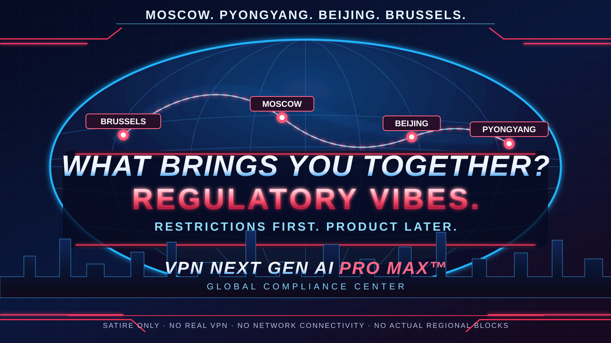

# VPN Next Gen AI Pro Max™ — Documentation Center

> **Documentation channel:** Enterprise Preview · **Product:** VPN Next Gen AI Pro Max™ · **Protocol:** NGT/0

**Notice:** This is a parody repository, not a functioning VPN. Its programs only print messages. No network privacy or security is provided.

Welcome to the official documentation for the world's most comprehensively documented *non-connection*.

## Why choose us?

Our [enterprise differentiation dossier](WHY_CHOOSE_US.md) outlines the strategic benefits of deploying a zero-packet architecture and why it should never be mistaken for a real VPN.

## Space Programs

- [Interplanetary Connectivity™ — Starman Edition](INTERPLANETARY_CONNECTIVITY.md) — our fictional Tesla Roadster mission, complete with theoretical light speed and exactly zero transmitted packets.

## Beyond Earth

- [Interplanetary Connectivity™ — Starman Edition](INTERPLANETARY_CONNECTIVITY.md) — theoretical light-speed signal propagation, zero actual Tesla connections, unlimited investor excitement

## Product documentation

| Area | Documentation | Operational objective |
| --- | --- | --- |
| Onboarding | [Getting started](GETTING_STARTED.md) | Reach your first non-connection in under a minute |
| Architecture | [System architecture](ARCHITECTURE.md) | Understand the industry's leanest data plane |
| Protocol | [NGT/0 specification](PROTOCOL.md) | Review the formal zero-packet wire protocol |
| Operations | [Operations runbook](OPERATIONS.md) | Manage a system with zero running services |
| Command line | [CLI reference](CLI_REFERENCE.md) | Learn our flagship connect and audit commands |

## Trust, governance & performance

| Area | Documentation | Operational objective |
| --- | --- | --- |
| Safety | [Security model](SECURITY.md) | Precisely understand what does **not** protect you |
| Compliance | [Global availability & export readiness](COMPLIANCE.md) | Simulate regulatory obstacles without checking your IP |
| Performance | [Benchmark methodology](BENCHMARKS.md) | Learn why p99 cannot be zero when it is undefined |
| Architecture records | [ADRs](adr/README.md) | Examine decisions made before there was a product |
| Release notes | [Project status](STATUS.md) | Separate actual code from roadmap and marketing |

## Corporate resources

- [Investor relations](INVESTOR_RELATIONS.md) — our valuation is a narrative, not a financial instrument
- [Roadmap](../ROADMAP.md) — planned monetization of a product that does not exist
- [FAQ](FAQ.md) — no question too premature
- [Contributing](../CONTRIBUTING.md) — the most stringent no-op review policy in the industry

## Compliance summary

| Jurisdiction | Marketing status | Effective software behavior |
| --- | --- | --- |
| UK | **UNDER REGULATORY VIBES REVIEW** | Prints local text |
| Australia | **KANGAROO-GRADE GATE PENDING** | Prints local text |
| Everywhere else | **GENERAL AVAILABILITY (NOT REALLY)** | Prints local text |

These are fictional, humorous statuses. No actual jurisdictional restriction, licensing fact, or external rule is asserted. We never inspect IP addresses or geolocate users.

[← Repository](../README.md) · [Getting started →](GETTING_STARTED.md)
